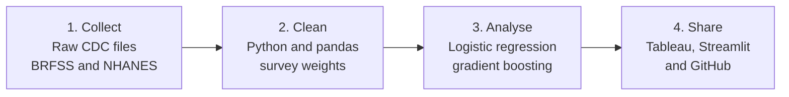

# Is memory loss only about age?

> **Business impact:** A targeting model that helps a public health team or health insurer decide **who to reach first**.
> Contacting the 20% of people the model ranks highest reaches **44.8%** of everyone reporting memory loss, **twice** as many as going oldest-first (22.2%).
> Tested on 52,043 people the model never saw · built on 208,171 CDC survey records · shared as a [Tableau dashboard](https://public.tableau.com/app/profile/lervin.de.la.rosa/viz/Ismemorylossonlyaboutage/Home) and an [11-page Streamlit app](https://memory-loss-analysis.streamlit.app/).
>
> *Stack: Python, pandas, weighted logistic regression, gradient boosting, Tableau, Streamlit · Solo capstone project*

*What people say about their memory, and how they score on memory tests (CDC BRFSS and NHANES)*

A data analytics final project in two parts, using two different CDC datasets:

| | **Part 1: BRFSS** | **Part 2: NHANES** |
|---|---|---|
| Memory measured by | People **say** their memory is getting worse | People **score low** on memory tests |
| Years | 2023 + 2024 | 2011–2012 + 2013–2014 |
| People | 208,171 aged 45+ | 2,934 aged 60+ |
| Younger vs older | 45–64 vs 65+ | 60–69 vs 70+ |
| Younger group | **16.1%** memory loss | **14.7%** low test score |
| Older group | **17.2%** memory loss | **38.0%** low test score |

Neither dataset gives a dementia diagnosis. The two datasets are about different people,
so they are analysed **separately** and only the results are compared.

**Short answer: no, memory loss is not only about age.** See [Comparison](#comparison-part-1-vs-part-2).

## Who could use this?

A public health team or health insurer deciding **which groups to reach first**. The data points to people
aged 45–64 with low income, depression or hearing problems. The results compare groups and show links, not
causes, so they should not be used to diagnose or judge one person.

**Example scenario (not a real client), for outreach only, never for pricing or refusing cover:** contacting the 20% of people the model ranks highest reaches **44.8%** of those reporting memory loss. Going oldest first reaches **22.2%**, and random 20%. Tested on 52,043 people the model did not train on. Details: [reports/business_results.md](reports/business_results.md). The app's **Outreach planner** page has a budget calculator (your own cost assumptions).

## How it was built



## Dashboard and app (Part 1: BRFSS)

**Tableau Public:** [Is memory loss only about age?](https://public.tableau.com/app/profile/lervin.de.la.rosa/viz/Ismemorylossonlyaboutage/Home)
Home page with KPI tiles; every page has the same button bar at the top (Home, Age, Income, Education,
Health, What predicts it?, Memory tests) and fits on one screen (1000 x 600). The **Memory tests** page puts
BRFSS (people say) and NHANES (people tested) side by side: *BRFSS asks people about their memory. NHANES
tests it. Using both lets me check whether the answer is the same.* Built from the small summary tables in
`tableau/` (`python src/make_dashboard_tables.py`; `dash_compare.csv` needs `src/nhanes_analysis.py` first).

**Live app:** [memory-loss-analysis.streamlit.app](https://memory-loss-analysis.streamlit.app/)
Streamlit app with 11 pages (Home KPIs, Age, Income, Education, Health, What predicts memory loss,
Memory tests (NHANES), Try the tests, Expectations vs data, Outreach planner, Risk checker). "Try the tests" has short versions of the 3 NHANES tests (own versions
of the NHANES tests: word recall, animal naming, symbol matching; nothing is saved). "Expectations vs data": choose what you expect, then see the real result. It only reads the summary tables in `tableau/`.

```bash
pip install -r requirements.txt
streamlit run app/streamlit_app.py
```

## Why this project

Most people think memory problems only come with old age. I want to find out what else
plays a role: education, income, health and lifestyle.

## The question

- Is memory loss only about age?
- Which factors matter most for younger adults?
- Are they the same factors as for older adults?
- Do we get the same answer when people **judge their own memory** (BRFSS) and when memory is **tested** (NHANES)?

---

## Part 1: BRFSS (self-reported memory loss)

**Data:** [BRFSS](https://www.cdc.gov/brfss/) (CDC), national files, 2023 and 2024. A phone survey of more
than 400,000 adults per year. The Cognitive Decline module asks people 45+ about "confusion or memory loss
that is happening more often or getting worse" (only some states).

| Year | Memory question | People 45+ who answered | States |
|---|---|---|---|
| 2022 | CIMEMLOS (old version) | 63,948 | 12 |
| 2023 | CIMEMLO1 (new version) | 134,033 | 28 |
| 2024 | CIMEMLO1 (new version) | 78,111 | 19 |

The module changed in 2023, so 2023 and 2024 are combined and 2022 is kept apart.
**Analysis table (2023 + 2024):** 208,171 people aged 45+ from 37 states.
High blood pressure is only asked in odd years, so it is available for 2023 only.

**Main findings**
- Memory loss is almost as common at 45–64 (16.1%) as at 65+ (17.2%).
- Low income matters most for younger people: 32.0% of the lowest income group vs 8.2% of the highest.
- Depression and hearing problems are strongly linked in both groups.

**Run it**
```bash
python src/download_brfss.py 2022 2023 2024
python src/first_look.py 2023
python src/build_table.py
python src/regression.py
python src/ml_model.py
python src/make_dashboard_tables.py
python src/business_analysis.py
```

Reports: [explore_notes.md](reports/explore_notes.md) · [statistics_notes.md](reports/statistics_notes.md) ·
[regression.md](reports/regression.md) · [ml_notes.md](reports/ml_notes.md)

---

## Part 2: NHANES (memory test scores)

**Data:** [NHANES](https://wwwn.cdc.gov/nchs/nhanes/) (CDC), public-use files, 2011–2012 and 2013–2014.
A health survey with a medical exam. People 60+ did three memory and thinking tests:
- **Word list:** learn 10 words, then recall them later (memory)
- **Animal naming:** name as many animals as possible in 1 minute (language, thinking speed)
- **Symbol matching:** match symbols to numbers in 2 minutes (attention, speed)

These are tests that doctors also use to **screen for dementia** (the word list comes from CERAD, a
research group on Alzheimer's disease). So Part 2 brings the project closer to dementia, but a low score
is **not** a dementia diagnosis.

**Low test score** = bottom 25% (weighted) of the combined score.
**Analysis table:** 2,934 people aged 60+ who did all the tests. Hearing was only asked in 2011–2012.

**Main findings**
- Low test scores are much more common at 70+ (38.0%) than at 60–69 (14.7%), and 55% at 80+.
- Low income, depression and no exercise are linked in both groups, after age is taken into account.
- Education is very strongly linked, partly because the tests reward reading and speed.

**Run it**
```bash
python src/download_nhanes.py
python src/build_nhanes.py
python src/nhanes_analysis.py
```

Report: [nhanes_results.md](reports/nhanes_results.md)

---

## Comparison: Part 1 vs Part 2

| Factor | Part 1: BRFSS (say) | Part 2: NHANES (tested) | Agree? |
|---|---|---|---|
| Low income | Strong link, mostly in younger people | Link in both groups | Yes |
| Depression | Very strong | Clear | Yes |
| No exercise | Small link | Small link | Yes |
| Stroke | Both groups | Older group | Yes |
| Age | Small effect | **Strong effect** | No |
| Education | Small effect | **Very strong effect** | No |
| Hearing | Strong link | Not clear (small sample) | No |

**In short:** it is not only about age in either dataset, but age matters more when memory is tested.
Full comparison: [reports/brfss_vs_nhanes.md](reports/brfss_vs_nhanes.md).

---

## Model card: the outreach model

A short summary of what the model is, how well it works and where it should not be used.

| | |
|---|---|
| **What it does** | Ranks people aged 45+ by how likely they are to report memory loss getting worse |
| **Intended use** | Helping a public health team or health insurer decide who to contact first for outreach |
| **Not for** | Diagnosing anyone, judging one person, setting prices or refusing cover, or replacing memory testing |
| **Model** | Gradient boosting (scikit-learn `HistGradientBoostingClassifier`, 300 trees, balanced classes). No trained model is shared |
| **Training data** | CDC BRFSS 2023 + 2024, 208,171 people aged 45+ from 37 US states and territories. 75% to train, 25% to test (52,043 people) |
| **Target** | Saying yes to "confusion or memory loss happening more often or getting worse" in the past 12 months. Self-reported, not a diagnosis |
| **13 inputs** | Age, sex, education, income, depression, hearing problem, stroke, COPD, heart disease, diabetes, no exercise, current smoker, obesity |
| **Missing values** | Kept as missing, which this model can handle. Income is unknown for 17% of people |

**How well it works** (on the 52,043 test people)

| Check | Result |
|---|---|
| ROC AUC, a score of how well it ranks people | 0.712 on test data (fair), 0.721 on training data |
| Reporting memory loss, top 10% of scores vs bottom 10% | 45.6% vs 5.3% |
| Share of cases reached by contacting 20% of people | Model 44.8%, oldest first 22.2%, random 20% |
| Using only 8 inputs a health record might hold | 43.8% reached |

**Different groups**

| Group | ROC AUC |
|---|---|
| Ages 45-64 | 0.743 |
| Ages 65+ | 0.680 |
| Women | 0.711 |
| Men | 0.713 |
| Income under $25k | 0.729 |
| Income $100k+ | 0.666 |

**Second survey check** (NHANES 2011-2014, ages 60+, using the 11 inputs both surveys share)

| Finding | Contacting 20%: model | Contacting 20%: oldest first |
|---|---|---|
| People who say they have memory problems | 41.3% | 30.4% |
| People with a low memory test score | 31.8% | 42.5% |

**Limits**
- It finds people who report memory loss **now**. BRFSS asks different people each year, so it cannot predict future decline.
- It was beaten by "oldest first" for low memory test scores, so it does not replace testing.
- It was not tested on real health records, which could give weaker results.
- It shows links, not causes.
- It does not use race or ethnicity, and it was **not** tested for fairness across those groups. Leaving them out does not make a model fair, because other inputs such as income are linked to them.
- The checks cover age, sex and income only. The NHANES inputs only roughly match BRFSS.

---

## Data terms (checked on 4 November 2026)

- **BRFSS national files:** no data use agreement on the [download page](https://www.cdc.gov/brfss/annual_data/annual_2023.html).
  State BRFSS files are NOT used (they have their own agreements).
- **NHANES:** the [NCHS Data User Agreement](https://www.cdc.gov/nchs/policy/data-user-agreement.html) applies:
  statistical use only, no attempt to identify anyone, no linking with identifiable data.
  It does not mention AI tools. Restricted / limited-access NHANES files are NOT used.
- **CDC reuse policy:** most CDC data is [public domain](https://www.cdc.gov/other/agencymaterials.html);
  credit the source and do not suggest that CDC endorses the work.
- Only group totals are shared (groups with fewer than 50 people are hidden). The raw data is not in this
  repository: download it with the scripts above.

## Project structure

```
src/
  Part 1: BRFSS
    download_brfss.py       download the national BRFSS files
    first_look.py           counts and percentages for the memory questions
    build_table.py          clean table, 2023 + 2024, people 45+ (with survey weights)
    regression.py           weighted logistic regression, 45-64 vs 65+
    ml_model.py             machine learning (logistic regression vs gradient boosting)
    make_dashboard_tables.py  summary tables for Tableau and the app
  Part 2: NHANES
    download_nhanes.py      download the NHANES 2011-2014 files
    build_nhanes.py         clean table, people 60+ with test scores (with survey weights)
    nhanes_analysis.py      percentages and weighted logistic regression, 60-69 vs 70+
app/                  Streamlit app (Part 1)
tableau/              summary tables, safe to share (dash_*.csv = BRFSS, nhanes_*.csv = NHANES)
reports/              results and charts
notebooks/            exploration
data/                 downloaded data (not uploaded)
```

(The `src/` files are all in one folder; the Part 1 / Part 2 split above is just for reading.)

## Credits

Centers for Disease Control and Prevention (CDC), Behavioral Risk Factor Surveillance System Survey Data,
2023 and 2024. Atlanta, Georgia: U.S. Department of Health and Human Services, CDC.

National Center for Health Statistics (NCHS), National Health and Nutrition Examination Survey Data,
2011-2012 and 2013-2014. Hyattsville, MD: U.S. Department of Health and Human Services, CDC.

The data is available on the [CDC website](https://www.cdc.gov/) at no charge.
This is a student project. It is not reviewed or endorsed by CDC, and the analysis and conclusions are my own.
